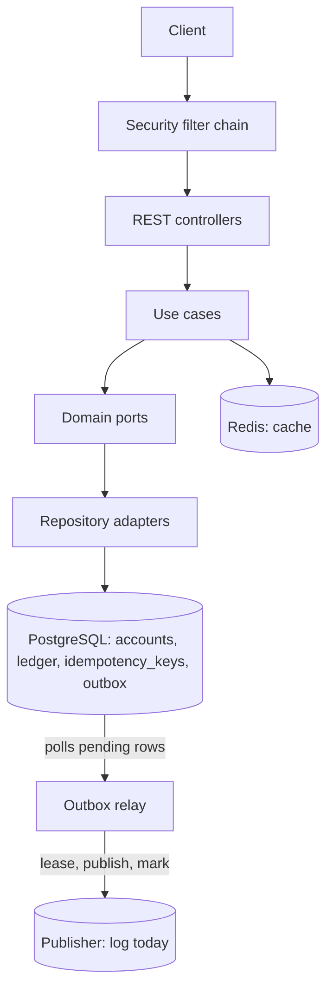

# Banking API — Core Banking REST API


Java 21 · Spring Boot 4 · PostgreSQL · Redis · Docker · GitHub Actions

A core banking REST API built to practice transactional correctness: accounts, deposits,
withdrawals, transfers and transaction history, with JWT/RBAC security, database-backed
idempotency committed with the ledger write, a **transactional outbox with an at-least-once
relay**, and pessimistic locking.

> **Reference implementation, not production software.** Known limitations are documented below.

---

## Quick start

```bash
cp .env.example .env
docker compose up --build -d
```

API: `http://localhost:8081`  
Swagger: `http://localhost:8081/swagger-ui.html`

Local demo admin: `admin@bank.com` / `Admin123!` (local only; change it before any real deployment).

---

## What it does

- 24 REST endpoints for customers, accounts, deposits, withdrawals, transfers and history.
- JWT authentication in HttpOnly/SameSite=Strict cookies, BCrypt and RBAC.
- Database-backed idempotency: the key, the movement and its two ledger entries commit in one
  transaction, with a unique `(principal, scope, key)`.
- Transactional outbox: the event is written in the same transaction as the money; a leased relay
  publishes it at-least-once, and consumers deduplicate by event id.
- Pessimistic locking in IBAN order to prevent deadlocks and lost updates.
- Flyway migrations, Bean Validation, OpenAPI/Swagger and Actuator.
- Integration tests against real PostgreSQL and Redis with Testcontainers.

### API surface

| Area | Endpoints |
|---|---|
| Auth | `POST /api/v1/auth/login`, `/refresh`, `/logout` |
| Customers | `POST /api/v1/customers`, `GET /api/v1/customers`, `GET /{id}`, `GET /me`, `PUT /{id}`, `PUT /me`, `DELETE /{id}`, `DELETE /me` |
| Accounts | `POST /api/v1/accounts/me`, `POST /admin`, `GET /me`, `GET /admin`, `DELETE /{iban}`, `DELETE /admin/{iban}` |
| Transactions | `POST /deposit`, `/withdraw`, `/transfer`, `/admin/deposit`, `/admin/withdraw`, `GET /movements/{iban}`, `GET /admin/movements/{iban}` |

---

## Stack

- Java 21, Spring Boot 4, Spring Security, Spring Data JPA/Hibernate
- PostgreSQL 16, Redis 7, Flyway
- JUnit 5, AssertJ, Mockito, Testcontainers
- Docker, Docker Compose, GitHub Actions, GHCR
- Prometheus, Grafana

---

## Architecture



Clean/Hexagonal boundaries: the domain has no Spring, the application layer orchestrates use
cases, and the infrastructure layer implements adapters.

### Project structure

- `com.banking.accounts` — account creation, states and balance queries.
- `com.banking.customers` — customer profiles, registration and credentials.
- `com.banking.transactions` — deposits, withdrawals and transfers.
- `com.banking.auth` — login, refresh and logout.
- `com.banking.shared` — security filters, JWT, exception handling, idempotency, Redis and the
  outbox (domain, relay, purge, adapters).
- `docs/adr` — architecture decision records.

---

## Idempotency

Money-moving endpoints accept `X-Idempotency-Key`. The key is stored in `idempotency_keys` with a
unique `(principal, scope, key)` constraint and committed **in the same transaction** as the
movement and its two ledger entries.

- **First request:** insert `PROCESSING`, write the money, update the row to `COMPLETED` with the
  response JSON, commit.
- **Retry after commit:** the insert hits `23505`; the transaction is rolled back and the stored
  response is read in a new transaction. The client gets `200` with the original body.
- **Same key, different payload:** `422` (SHA-256 fingerprint of IBANs + normalized amount).
- **Business failure:** the whole transaction rolls back, including the key, so a retry can execute.
- **Retention:** 24 hours; a daily job deletes expired rows.
- The duplicate read happens outside the transaction because PostgreSQL aborts it on a unique
  violation (`current transaction is aborted`).

---

## Outbox

Every committed transfer writes one row to `outbox` **in the same transaction** as the movement and
its two ledger entries. Money and event commit or roll back together; there is no dual write.

- **Relay:** a scheduled job polls pending rows, claims one with a lease (conditional `UPDATE`), publishes it and only then sets `published_at`. A crashed relay releases the row when the lease expires. A partial index on `published_at IS NULL` keeps the poll cheap.
- **Delivery is at-least-once, not exactly-once.** A crash between publish and mark produces a duplicate, so consumers must deduplicate by `outbox.id` (stable across retries). Exactly-once delivery is not achievable across two systems; saying otherwise would be wrong.
- **Purge:** published rows are audit-only and are deleted after `outbox.purge.retention-days` (7 by default). Pending events are never deleted, however old they are.
- **Why not publish after the commit?** A crash in that gap loses the event; publishing inside the transaction exposes events for money that rolled back. See [ADR 0001](docs/adr/0001-transactional-outbox.md).

---

## Key decisions

| Decision | Why | Trade-off |
|---|---|---|
| JWT in HttpOnly cookies with `SameSite=Strict` | Reduces token theft via XSS; SameSite mitigates CSRF | CSRF token is the next hardening step |
| Database-backed idempotency in the money transaction | A retry cannot duplicate a committed operation, even if the process dies | 24 h retention; external side effects are covered by the outbox |
| Transactional outbox instead of publishing after the commit | The event cannot be lost when the process dies between commit and publish | At-least-once delivery: consumers must deduplicate by event id |
| Leased claim instead of a status column machine | A crashed relay frees its row automatically; no stuck `PROCESSING` state | One extra timestamp (`claimed_at`) and cutoff rules |
| One application `Clock` bean for windows, leases and purges | The writer and the reader of a timestamp can never disagree | Slightly more wiring; domain factories still use `now()` |
| Pessimistic locking in IBAN order | Prevents lost updates and A→B/B→A deadlocks | Hot accounts serialize; optimistic locking is a future comparison |
| Explicit transactions with `TransactionTemplate` | Transaction boundaries are visible | More wiring than `@Transactional` |
| Cache-aside with fallback | Reads survive Redis outages | A failed eviction can leave stale data until TTL |
| Testcontainers instead of H2 | Tests run against real PostgreSQL and Redis | Slower CI, requires Docker |

---

## Tests and quality

```bash
./mvnw clean verify
```

- **108 tests**, 0 failures.
- **88.02% instruction coverage**, **90.87% line coverage**, **59.25% branch coverage**.
- Integration tests with **Testcontainers** against PostgreSQL 16 and Redis 7.
- CI enforces the **85% instruction coverage** gate.
- JaCoCo report: `target/site/jacoco/index.html`.

---

## Run locally

```bash
cp .env.example .env
docker compose up --build -d
```

Required variables (see `.env.example`):

- `DB_NAME`, `DB_USERNAME`, `DB_PASSWORD`
- `JWT_SECRET` (at least 32 characters)
- `REDIS_HOST`, `REDIS_PORT`
- `COOKIE_SECURE` (`false` locally, `true` behind HTTPS)

Run without Docker:

```bash
SPRING_PROFILES_ACTIVE=dev ./mvnw spring-boot:run
```

Windows PowerShell:

```powershell
$env:SPRING_PROFILES_ACTIVE="dev"; .\mvnw.cmd spring-boot:run
```

### Profiles

| Profile | Behavior |
|---|---|
| `dev` | SQL logging, stack traces, full Actuator health |
| `prod` | No SQL logging, no stack traces, limited Actuator |

---

## Known limitations

- **Idempotency keys expire after 24 hours.** The daily purge job deletes them; after that window
  the same key can execute again. This is the same contract the previous Redis TTL had.
- **External side effects are handled by the outbox, which delivers at-least-once.** A consumer that
  is not idempotent can process the same event twice; deduplication by `outbox.id` is the consumer's
  job and there is no consumer implemented yet.
- **No `lock_timeout` on the idempotency insert.** A hung transaction makes concurrent retries
  with the same key wait until it finishes.
- **The outbox purge is a single `DELETE`.** Fine at this volume; with millions of published rows
  it should run in batches to keep transactions short.
- **Branch coverage is 59.25%.** Happy paths are covered; security error paths and cache
  fallbacks are the next target.
- **No rate limiting on authentication endpoints.** Add Redis/Bucket4j throttling and account
  lockout before exposing login publicly.
- **No load test or p95/p99 measurement yet.** Add k6/Gatling before claiming throughput.
- **Cookie `Secure` flag defaults to false for local HTTP.** Set `COOKIE_SECURE=true` in production.
- **Pessimistic locking only on `accounts`.** Optimistic `@Version` is a future comparison.

---

## Roadmap

1. Idempotent consumer for outbox events (dedup by event id).
2. Rate limiting on auth + CSRF token.
3. k6 load test with p95/p99.
4. Reconciliation job (`sum(entries) == balance`).
5. `lock_timeout` + 409 on in-flight idempotency retries.
6. Batched outbox purge.

---

## Repository

`github.com/rubenbecerra/banking-api`