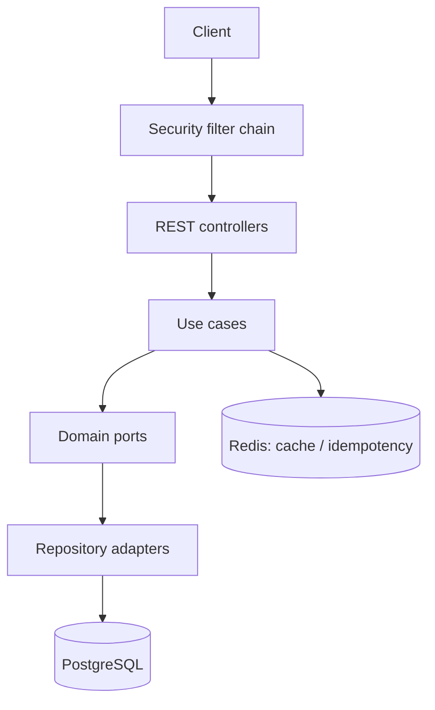

# Banking API — Core Banking REST API


Java 21 · Spring Boot 4 · PostgreSQL · Redis · Docker · GitHub Actions

A core banking REST API built to practice transactional correctness: accounts, deposits,
withdrawals, transfers and transaction history, with JWT/RBAC security, Redis-backed idempotency
and pessimistic locking.

> **Reference implementation, not production software.** Known limitations are documented below.

---

## Quick start

```bash
cp .env.example .env
docker compose up --build -d
```

API: `http://localhost:8081`  
Swagger: `http://localhost:8081/swagger-ui.html`

Local demo admin: `admin@bank.com` / `Admin123!` (local only; change it before any real deployment).

---

## What it does

- 24 REST endpoints for customers, accounts, deposits, withdrawals, transfers and history.
- JWT authentication in HttpOnly/SameSite=Strict cookies, BCrypt and RBAC.
- Redis-backed idempotency scoped per user and operation.
- Pessimistic locking in IBAN order to prevent deadlocks and lost updates.
- Flyway migrations, Bean Validation, OpenAPI/Swagger and Actuator.
- Integration tests against real PostgreSQL and Redis with Testcontainers.

### API surface

| Area | Endpoints |
|---|---|
| Auth | `POST /api/v1/auth/login`, `/refresh`, `/logout` |
| Customers | `POST /api/v1/customers`, `GET /api/v1/customers`, `GET /{id}`, `GET /me`, `PUT /{id}`, `PUT /me`, `DELETE /{id}`, `DELETE /me` |
| Accounts | `POST /api/v1/accounts/me`, `POST /admin`, `GET /me`, `GET /admin`, `DELETE /{iban}`, `DELETE /admin/{iban}` |
| Transactions | `POST /deposit`, `/withdraw`, `/transfer`, `/admin/deposit`, `/admin/withdraw`, `GET /movements/{iban}`, `GET /admin/movements/{iban}` |

---

## Stack

- Java 21, Spring Boot 4, Spring Security, Spring Data JPA/Hibernate
- PostgreSQL 16, Redis 7, Flyway
- JUnit 5, AssertJ, Mockito, Testcontainers
- Docker, Docker Compose, GitHub Actions, GHCR
- Prometheus, Grafana

---

## Architecture



Clean/Hexagonal boundaries: the domain has no Spring, the application layer orchestrates use
cases, and the infrastructure layer implements adapters.

### Project structure

- `com.banking.accounts` — account creation, states and balance queries.
- `com.banking.customers` — customer profiles, registration and credentials.
- `com.banking.transactions` — deposits, withdrawals and transfers.
- `com.banking.auth` — login, refresh and logout.
- `com.banking.shared` — security filters, JWT, exception handling and Redis.

---

## Key decisions

| Decision | Why | Trade-off |
|---|---|---|
| JWT in HttpOnly cookies with `SameSite=Strict` | Reduces token theft via XSS; SameSite mitigates CSRF | CSRF token is the next hardening step |
| Redis-backed idempotency, scoped per user | Safe retries on network failures | Not atomic with the database commit (see limitations) |
| Pessimistic locking in IBAN order | Prevents lost updates and A→B/B→A deadlocks | Hot accounts serialize; optimistic locking is a future comparison |
| Explicit transactions with `TransactionTemplate` | Transaction boundaries are visible | More wiring than `@Transactional` |
| Cache-aside with fallback | Reads survive Redis outages | A failed eviction can leave stale data until TTL |
| Testcontainers instead of H2 | Tests run against real PostgreSQL and Redis | Slower CI, requires Docker |

---

## Tests and quality

```bash
./mvnw clean verify
```

- **75 tests**, 0 failures.
- **87.21% instruction coverage**, **90.25% line coverage**, **60.44% branch coverage**.
- Integration tests with **Testcontainers** against PostgreSQL 16 and Redis 7.
- CI enforces the **85% instruction coverage** gate.
- JaCoCo report: `target/site/jacoco/index.html`.

---

## Run locally

```bash
cp .env.example .env
docker compose up --build -d
```

Required variables (see `.env.example`):

- `DB_NAME`, `DB_USERNAME`, `DB_PASSWORD`
- `JWT_SECRET` (at least 32 characters)
- `REDIS_HOST`, `REDIS_PORT`
- `COOKIE_SECURE` (`false` locally, `true` behind HTTPS)

Run without Docker:

```bash
SPRING_PROFILES_ACTIVE=dev ./mvnw spring-boot:run
```

Windows PowerShell:

```powershell
$env:SPRING_PROFILES_ACTIVE="dev"; .\mvnw.cmd spring-boot:run
```

### Profiles

| Profile | Behavior |
|---|---|
| `dev` | SQL logging, stack traces, full Actuator health |
| `prod` | No SQL logging, no stack traces, limited Actuator |

---

## Known limitations

- **Redis idempotency is not atomic with the database commit.** A Redis failure after the commit
  can delete the key and allow a retry to duplicate the operation. The next step is a
  database-backed idempotency key written in the same transaction as the money movement.
- **Branch coverage is 60.44%.** Happy paths are covered; security error paths and cache
  fallbacks are the next target.
- **No rate limiting on authentication endpoints.** Add Redis/Bucket4j throttling and account
  lockout before exposing login publicly.
- **No load test or p95/p99 measurement yet.** Add k6/Gatling before claiming throughput.
- **Cookie `Secure` flag defaults to false for local HTTP.** Set `COOKIE_SECURE=true` in production.
- **Pessimistic locking only on `accounts`.** Optimistic `@Version` is a future comparison.

---

## Roadmap

1. Database-backed idempotency (same transaction as the money movement).
2. Transactional outbox + relay for events.
3. Rate limiting on auth + CSRF token.
4. k6 load test with p95/p99.
5. Reconciliation job (`sum(entries) == balance`).

---

## Repository

`github.com/rubenbecerra/banking-api`